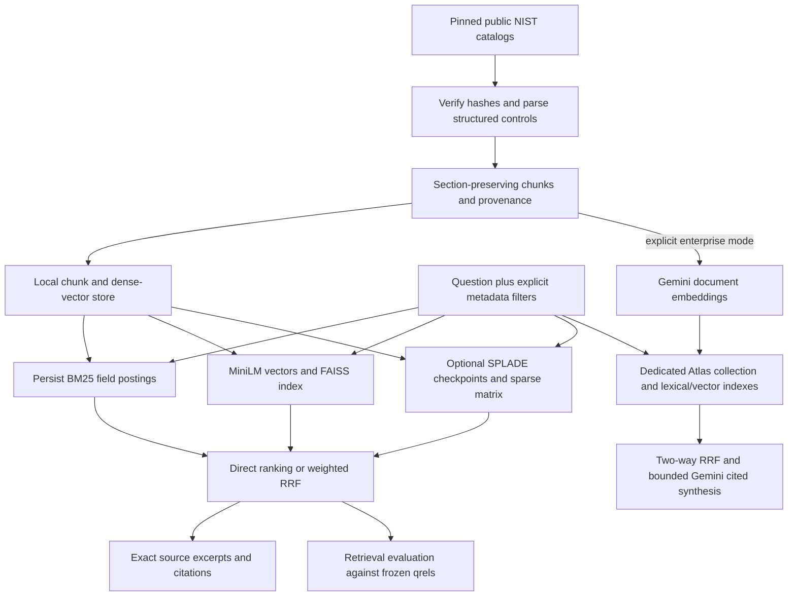

# End-to-end implementation and explanation guide

This document explains the actual repository so a reader or another agent can explain the system without needing the earlier conversation. It covers the problem, data, preparation, model use, persistence, retrieval, answers, evaluation, execution, operations and limits. Source links provide an audit trail; the explanations here stand on their own. Historical experiments and current configurations are identified separately.

## 1. What the project does

The use case is version-aware enterprise policy and compliance knowledge retrieval. Exact control numbers, technical terms, semantic paraphrases and document versions all matter. A dense-only question embedding can miss an exact identifier; a lexical-only search can miss a paraphrase. The implementation compares these representations and combines their ranked evidence.

The working corpus is public NIST SP 800-53 security and privacy control catalogs, rather than private company policies. The two source releases are `rev4` and `rev5`. They are not fictional company policies dated 2024 and 2025. A question about those calendar years is not automatically mapped to NIST releases.

The application can retrieve relevant excerpts, return their provenance, present cited answers, compare a named control between releases and benchmark retrieval. It does not automatically produce an exhaustive semantic or legal comparison of every changed procedure across two complete policy libraries. Its `compare` command performs exact textual comparison for the requested control.

The architecture changed during implementation. The current decision is **local retrieval as the primary research implementation**, with **MongoDB Atlas/Gemini as an explicit cloud hybrid fallback**. Older reports preserve the earlier enterprise-first context. The current default is always local; credentials in the environment do not silently choose a cloud backend.

| Configuration | Lexical | Dense | Learned sparse | Fusion | Answers |
|---|---|---|---|---|---|
| Default local grading | Persisted field-aware BM25 | Bundled quantized ONNX MiniLM + FAISS | Not required | Two-way RRF (`hybrid`) | Extractive NLP with citations |
| Optional local research | Same BM25 | Same MiniLM + FAISS | Pinned NAVER SPLADE | Three-way RRF (`blended`) | Same extractive NLP |
| Explicit enterprise fallback | Atlas Search | Gemini embeddings + Atlas Vector Search | Unsupported in Atlas adapter | Two-way client RRF | Gemini synthesis by default; extractive option |
| Preserved historical experiments | Local BM25 | TF-IDF/LSA or full-precision MiniLM | Not part of historical runs | Two-way RRF | Extractive NLP |

No reranker is implemented or benchmarked. No cross-encoder, SPLADE fine-tuning, ingestion queue or production orchestration service should be inferred from the architecture.

**Current resource decision:** SPLADE stays disabled by default. Real vectors for 12,672 of the full 20,114 chunks were persisted before CPU-intensive document inference was stopped. Optional partial-corpus verification is separate from the full-corpus BM25/MiniLM system; it does not establish full-corpus SPLADE quality. No further document encoding is needed to assemble/search those already saved vectors. Section 18 records the exact scope and observed verification.

## 2. The whole system at a glance



Indexing happens before serving searches. At query time, the question is encoded where needed; the corpus is not re-embedded. Each branch returns `Hit(chunk, score)` objects using the same chunk metadata. Fusion joins on `chunk_id`, so the three branches refer to the same evidence records.

## 3. Dataset, provenance and chunk schema

[The source manifest](../src/data/manifest.json) pins the upstream OSCAL content commit `78650f02ad9321bb7b817846f8fbd4f2bcd620de`, source URLs and SHA256 values. The corpus has **20,114 chunks**, derived from **922 Rev4 control records** and **1,196 Rev5 control records**. Nested control enhancements are included. Rev4's catalog version is `2015-01-22`; Rev5's is `5.2.0`, including assessment procedures.

The raw structured JSON catalogs are bundled as gzip files in `src/data`. Normal ingestion decompresses those files and verifies the hash of the uncompressed bytes. `download` is an explicit alternative: it retrieves the immutable URLs, verifies the same hashes and replaces the bundled gzip copies. Source loading is implemented in [dataset.py](../src/blended_rag/dataset.py).

The NIST upstream license is US public domain with worldwide CC0, as recorded in the manifest. Model licenses are separate from the document license.

Each immutable [Chunk](../src/blended_rag/models.py) contains:

| Field | Meaning |
|---|---|
| `chunk_id` | SHA256 of the structural source/release/control/section identity |
| `source_id` | Catalog family, currently `nist-800-53` |
| `release` | `rev4` or `rev5` |
| `control_id` | Exact OSCAL control/enhancement identifier, for example `cp-9` |
| `section_id` | Technical section identity plus the split number |
| `title` | Control title |
| `text` | Normalized chunk prose or preserved parameter/metadata content |
| `source_url` | Immutable HTTPS source URL |
| `source_hash` | SHA256 of the complete raw source file |
| `content_hash` | SHA256 of this chunk's normalized text |

Chunk construction checks nonempty string fields, HTTPS provenance and matching content hashes. A stable structural `chunk_id` is not proof that text stayed unchanged; content and complete-record hashes serve that separate purpose. Catalog versions live in the source manifest; the chunk stores the release tag and source hash.

## 4. Parsing and chunking

`parse_catalog` in [ingestion.py](../src/blended_rag/ingestion.py) recursively traverses catalog groups, controls, nested enhancements and nested prose parts.

1. Read the control ID and title.
2. Traverse nested prose sections, retaining a supplied part ID or generating a deterministic path when it is absent.
3. Preserve organization-defined parameter definitions and selection choices as separate entries. The implementation does not invent the organization's actual parameter values.
4. If a control has no prose, retain available metadata such as withdrawal/incorporation links in a metadata excerpt.
5. Normalize whitespace and split each section into non-overlapping chunks of at most **180 words**. Chunks never cross section boundaries. This is word-based splitting, not a sentence-aware semantic splitter; a boundary can cut a sentence.
6. Append a split number to the section ID, derive the structural chunk hash and attach source/content hashes.

There is no PDF OCR stage: the input is structured OSCAL JSON. Section IDs are technical identifiers, not guaranteed human-readable family headings. The parser does not store a separate `description` field; the prose body is `text`. These details matter when explaining which fields the search actually indexes.

## 5. Training, fitting, inference and quantization

**We did not train or fine-tune a transformer on NIST or company data.** The project has no training loss, optimizer, epochs, gradient updates or supervised fine-tuning pipeline. Generating and indexing document embeddings is inference, even when it takes a long time.

| Component | What happens in this project | Does it update neural weights? |
|---|---|---|
| BM25 | Count tokens, estimate document frequency/IDF and compute length-normalized term weights | No |
| Bundled ONNX MiniLM | Run inference with a fixed pretrained quantized representation | No |
| Historical full-precision MiniLM | Run a pinned pretrained Sentence Transformer | No |
| SPLADE | Run a pinned pretrained sparse encoder for documents and questions | No |
| Gemini embeddings/answers | Call configured hosted pretrained models | No |
| Historical LSA | Fit TF-IDF vocabulary/statistics and truncated SVD on the corpus | Statistical fitting; no transformer training |
| Field boosts and RRF | Apply explicit constants/weights | No learned fusion model |

The fixed encoder `fit()` methods return the encoder without learning. LSA's `fit()` is different: it actually fits corpus-dependent TF-IDF and SVD. Its vectors must be rebuilt when the fitted corpus changes. Calling every vector representation “MiniLM embeddings” would therefore be incorrect.

The local ONNX artifact is quantized to reduce model size and support credential-free CPU execution. Quantized inference is not fine-tuning. Its measurements are kept separate from the historical full-precision MiniLM measurements.

The small relevance judgments are used for evaluation, not neural training. Field weights are predefined experiment settings, not a model trained on those judgments. There is no claim of independent held-out validation.

### The actual fitted LSA procedure

For the preserved `tfidf-lsa-64-v1` baseline, `Encoder.fit(chunks)` constructs one title/control-ID/text string per chunk. It fits `TfidfVectorizer(lowercase=True, sublinear_tf=True, max_features=30000)` with the Unicode word/hyphen token pattern in the source. This builds corpus vocabulary and term statistics. It then fits `TruncatedSVD` with `random_state=42` and component count `min(64, max(1,N-1), max(1,V-1))`, where N is the document count and V the vocabulary size.

To encode a document or question, it applies the fitted TF-IDF transform, the fitted SVD projection and L2 normalization. The fitted vectorizer/SVD are persisted in the encoder joblib. The model fingerprint includes corpus-dependent identity; a changed corpus is refitted rather than pretending old and new statistical bases are compatible. There are no labeled target answers, loss-function optimization or transformer updates in this procedure.

The original training of the public MiniLM/SPLADE checkpoints and hosted Gemini models was performed by their providers, not reproduced or independently audited in this repository. This project does not supply original pretraining datasets, epochs or training hyperparameters for those external weights. Model inference settings below are our settings and should not be described as their training settings.

## 6. Neural dense retrieval: MiniLM and FAISS

[OnnxEncoder](../src/blended_rag/providers.py) uses bundled model/tokenizer/configuration files in `src/assets/minilm`. Their SHA256 manifest pins the upstream MiniLM revision `1110a243fdf4706b3f48f1d95db1a4f5529b4d41`. The runtime model name is `all-MiniLM-L6-v2-onnx-quint8`; embeddings have **384 dimensions**. Apache-2.0 model attribution is bundled.

The document input is `title + " " + control_id + " " + text`; question input is the raw question. Encoding tokenizes with a 256-token limit, runs ONNX on CPU in batches of 32, performs attention-mask mean pooling and L2-normalizes each vector. CPU intra-op threads are bounded at four and inter-op threads at one. Model files are verified before use; runtime does not fetch them.

With normalized vectors, inner product is cosine similarity. `LocalStore.ingest` builds an actual **FAISS `IndexFlatIP`** with one row per ordered chunk. This is exact flat search, not an approximate HNSW index. The artifact metadata binds model fingerprint, dimensions, ordered chunk IDs, metric and file hash.

`FaissRetriever` validates that metadata and hash, reloads the disk index and checks the vector count/dimensions. An unfiltered query searches the persisted index. A filtered query selects matching metadata rows and constructs a temporary FAISS subset before top-k, so irrelevant releases cannot consume result slots. Returned ties are sorted by score and chunk ID. The subset construction is suitable for this assessment corpus; it is not a demonstrated million-document filter strategy.

The historical `NeuralEncoder` uses `sentence-transformers/all-MiniLM-L6-v2`, the same pinned upstream revision, CPU batches of 64 and normalized vectors. It is an explicit optional path that may download its model. It is not the default bundled ONNX runtime.

## 7. The genuine embedding cache and local updates

`src/assets/corpus-minilm.npz` holds genuinely computed float32 corpus vectors, not expected answers or query rankings. It contains no query lookup table. Every incoming question still runs through the real encoder and FAISS.

Cache identity includes the encoder fingerprint, dimensions and a hash of **every complete ordered chunk record**. Matching inputs reuse the document vectors. A source/chunk mismatch prevents using that bundled cache; preparation then follows normal incremental reuse or actual encoding according to whether compatible earlier input vectors exist. A different cache model fingerprint is rejected. Loaded vectors must have the expected shape and finite values. NumPy cache loading disables pickle.

The local store is `artifacts/runtime-local/store.json`, containing chunk records, dense vectors, model identity and FAISS metadata. A small `encoder-<fingerprint>.joblib` stores the encoder wrapper; it is not the full bundled ONNX weight file. Only trusted locally generated joblib files should be loaded.

On ingestion, records for incoming `(source_id, release)` pairs replace those pairs; other releases remain. Unchanged merged records return `changed=false` and embed zero chunks. For fixed models, unchanged title/control/text records can reuse earlier vectors while changed inputs are encoded. Changed LSA corpora refit all vectors. Preparation completes before an atomic replacement of `store.json`, preserving the previous state on failure. Old generated files are not automatically garbage-collected.

`export-cache` exports vectors from an existing verified fixed-model store. It is not a substitute for the initial real encoding that created those vectors.

## 8. BM25: fields, scoring and disk postings

[retrieval.py](../src/blended_rag/retrieval.py) prepares corpus statistics; [postings.py](../src/blended_rag/postings.py) persists weighted inverted postings. BM25 preparation happens when a local retriever is first constructed, such as the first query after ingestion; `ingest` itself prepares the dense store/FAISS.

The tokenizer lowercases and extracts ASCII letters/numbers with internal hyphens. The formula uses `k1=1.5`, `b=0.75`:

```text
idf(t) = ln(1 + (N - df(t) + 0.5) / (df(t) + 0.5))
term_score(t,d) = idf(t) * tf(t,d) * (k1 + 1)
                  / (tf(t,d) + k1 * (1 - b + b * length(d)/average_length))
```

Unique query terms contribute once. Length is tokenizer-term count, not character count. The combined document is title + control ID + text. Separate field indexes have their own lengths, average lengths and IDF. Exact `control_id` field scoring uses whole lowercase IDs rather than ordinary body tokenization.

| Profile | Fields | Combination |
|---|---|---|
| `combined` (default) | Concatenated title/control ID/text | One BM25 representation |
| `content-only` | `text` | Body-only score |
| `multi-field` | `control_id`, `title`, `section_id`, `text` | Sum with equal field weights |
| `boosted-sum` | Same separate fields | Sum with weights 8 / 3 / 1.5 / 1 |
| `best-fields` | Same separate fields | Maximum of the weighted field scores |

`raw` question formulation retains the question. `identifier` formulation detects whole IDs such as `CP-9.1` independently of qrels and restricts lexical candidates to those IDs when any are detected. It does not rewrite the dense or SPLADE question. Ordinary raw field-aware search also recognizes exact ID clauses, without restricting all lexical candidates to them.

The on-disk BM25 matrices use SciPy **CSC**: each vocabulary column identifies matching document rows and precomputed weights. Query scoring follows matching term postings instead of scanning every document Counter for each term. It still allocates N-document score arrays and sorts eligible results; it is not a complete production search engine.

`bm25-ready.json` and field `.npz` files bind format, tokenizer, constants, ordered complete source identity, field names, vocabulary, matrix shapes and payload hashes. Publication is atomic. Counters/reference scoring remain for diagnostics and tests. Stale/corrupt manifests fail explicitly; remove the BM25 ready manifest to request a rebuild from the trusted current store.

## 9. SPLADE: learned sparse retrieval and persistence

[sparse.py](../src/blended_rag/sparse.py) uses the actual Sentence Transformers `SparseEncoder` with model **`naver/splade-cocondenser-ensembledistil`**, pinned to revision **`49cf4c7b0db5b870a401ddf5e2669993ef3699c7`**. Its license is **CC-BY-NC-SA-4.0**, attributed to NAVER. These optional weights are not bundled in Git.

The configured representation is max-pooled `log(1 + ReLU(masked-language-model logits))`, with **30,522 vocabulary dimensions**, a **256-token** input limit and no vector normalization. Most dimensions are zero. Nonzero dimensions represent learned vocabulary-term weights; terms can be activated even when they are not literal query words. `sparse-inspect` prints actual token dimensions/weights. It does not use a handwritten synonym list or an LLM to invent expansions.

Document input is title + control ID + text. `encode_document` runs once during indexing; `encode_query` runs for each incoming question. This sparse representation is combined-text encoding, not a separately scored SPLADE index for every BM25 field. Document vectors are not LSA and are not ordinary MongoDB text postings.

Only explicit `sparse-setup` permits a model download. Encoding resolves the pinned snapshot with `local_files_only=True`. Torch and Sentence Transformers imports are lazy, so the default base-only runtime never needs them. Missing optional dependencies, cached weights or a ready sparse index produce errors; the code never silently substitutes BM25/LSA results for SPLADE.

The sparse store is separate from FAISS:

```text
artifacts/runtime-local/sparse/
  checkpoint-<generation>-128.json
  batch-<generation>-128-0.npz
  batch-<generation>-128-1.npz
  ...
  index-<generation>.npz
  ready.json
```

The actual experiment uses four CPU threads, inference batches of eight and persisted checkpoint batches of 128 documents. These batch sizes are different controls. Model inference batches bound memory; checkpoint batches limit repeated disk writes while allowing restart. Both sizes are bounded; the public provider permits 1–32 threads and 1–128 inference batch size, and the store permits checkpoint size 1–128.

Generation identity includes the complete ordered source hash, document count, format version, model/revision, vocabulary dimensions, representation, pooling, normalization and token limit. Resume validates checkpoint identity, expected batch count/order/filenames, file hashes, sparse structure, row counts and finite nonnegative weights. This prevents vectors from being attached to different chunk rows by reordered checkpoints.

Each completed batch is saved atomically before its checkpoint is published. The final matrix is assembled as SciPy **CSR**, one row per document, and `ready.json` is published only after the entire build validates. An interrupted build cannot publish a partial full-corpus index. A previous ready generation remains authoritative until replacement succeeds; an incompatible source/model is rejected on load.

Searching computes `document_matrix @ query_vector.T`. For a document `d`, the score is `sum_t document_weight[d,t] * query_weight[t]`. There is no BM25 IDF multiplication or L2 normalization on this branch. The corpus-by-vocabulary dense matrix is never materialized; only the resulting N-document score vector is dense. Metadata selection precedes the final top-k.

Repeated indexing against a valid ready identity reloads/verifies it and returns `changed=false` without encoding documents. Corrupt artifacts are rejected rather than silently repaired. For a corrupt assembled matrix, preserve a diagnostic backup, remove its ready pointer and rebuild from verified matching batch checkpoints. If checkpoints themselves are corrupt, move the sparse directory aside and rebuild from the trusted chunk store.

## 10. Fusion and one complete local question

The public methods are `lexical`, `dense`, `sparse`, `hybrid` and `blended`. Direct methods return their own score ranking. `hybrid` always combines BM25 and dense. `blended` additionally includes SPLADE and requires a positive sparse weight and ready index. Default weights are lexical=1, dense=1, sparse=0. Zero-weight branches are not searched. Sparse-only can be selected directly regardless of sparse weight.

Weighted reciprocal rank fusion computes:

```text
RRF_score(document) = sum_over_enabled_branches(weight / (60 + rank_in_branch))
```

It combines ranks, not raw BM25/cosine/SPLADE scores, whose scales differ. Agreement across branches accumulates score. Fusion uses unique chunk identities and deterministic final score/chunk-ID sorting. Normal query branch pools are `min(100, max(50, 5*k))`; final k is bounded to 1–100. Evaluation requests a pool of 100.

For a three-way query about departing employees:

1. Validate the question and exact metadata filters.
2. BM25 tokenizes the question and scores matching postings for the chosen lexical profile.
3. MiniLM encodes the raw question; FAISS searches eligible dense vectors.
4. SPLADE encodes the raw question; the persisted CSR matrix supplies weighted sparse scores.
5. Each branch ranks eligible chunks; weighted RRF merges them.
6. Extractive NLP selects relevant source excerpts from the final evidence and attaches citations.
7. The response identifies models, retrieval configuration, source hashes, releases and answer engine.

The IBM Blended-RAG work inspired representation/field/query experiments. This repository's RRF pipeline is not an exact reproduction of IBM's reported query strategies, learned sparse backend or research results. No IBM benchmark number is presented as a measurement of this NIST implementation.

## 11. Answer presentation and version comparison

[answers.py](../src/blended_rag/answers.py) separates retrieval from answer presentation. **There is no local generative LLM.** Local mode uses deterministic extractive NLP: split retrieved chunk text into sentence-like excerpts, remove common question stopwords, measure query-token overlap against excerpt/title/control ID, deduplicate text and select up to five excerpts. If the strongest overlap ratio is below 0.2, it returns insufficient evidence. This heuristic is transparent but uncalibrated. Chunk boundaries and whitespace normalization mean an excerpt may be a fragment of an original sentence.

The local answer quotes retrieved text and appends numeric citations. Each selected citation includes the complete chunk metadata and retrieval score, so the reader can recover the source release, control, section, URL and hashes. Semantic matches without enough lexical overlap can still lead to an extractive abstention. Retrieval recall therefore does not measure the quality or completeness of this answer layer.

Enterprise mode normally requests Gemini synthesis. It supplies at most ten retrieved excerpts, truncates each to 2,400 characters, marks evidence as untrusted, requests source-grounded JSON and bounds generation at 1,200 output tokens with temperature zero. `GEMINI_CHAT_MODEL` defaults to `gemini-2.5-flash`; the preserved successful live example used `gemini-3.1-flash-lite` under private configuration. The embedding model and answer model are different models with different jobs.

The response must contain an answer, citation IDs and an insufficiency flag. Unknown/out-of-range IDs or disagreement between inline citations and declared IDs cause failure. Insufficient evidence produces an explicit abstention. These checks validate citation references, not semantic entailment of every claim. No local substitution occurs after a cloud failure. Enterprise can explicitly select `--answer-engine extractive-nlp` when hosted synthesis is not wanted.

`compare` gathers the named control's excerpts for two releases, sorts them by section ID and returns both sets plus a unified textual diff. It reports absent controls and rejects comparing a release to itself. This supports source review; it does not establish legal meaning, an exhaustive semantic procedure mapping or an automatically approved policy update.

## 12. MongoDB Atlas/Gemini fallback in detail

Enterprise mode uses [AtlasRetriever](../src/blended_rag/atlas.py), the configured existing authorized Atlas database, and a dedicated experiment namespace:

| Object | Name / purpose |
|---|---|
| Chunk collection | `aintropy_blended_nist_gemini768_v1` |
| Active-source pointers | `aintropy_blended_nist_gemini768_v1_sources` |
| Original lexical index | `aintropy_nist_gemini_text_v1` |
| Vector index | `aintropy_nist_gemini_vector_v1` |
| Additive field-aware lexical index | `aintropy_nist_gemini_fields_v2` |

The enterprise entry point enforces the dedicated collection and original index names. It is not supposed to write into the existing KMS POC's other collections. A changed model/dimension/namespace requires an explicit reviewed migration; setting arbitrary new collection names is not supported by this guarded enterprise mode. Legacy generic adapters remain for historical compatibility and should not be confused with this protected setup.

Gemini defaults to `gemini-embedding-001`, **768 dimensions**. Document calls use `RETRIEVAL_DOCUMENT`, question calls `RETRIEVAL_QUERY`; results are finite/dimension-checked and L2-normalized. Document requests use batches of 32 with at most four concurrent workers while preserving output order. The application allows three attempts with exponential delay; the SDK is configured for one attempt per application call and a 60-second HTTP timeout. Attempt counters include retries. Generation has its own request/token counters.

Atlas ingestion groups prepared vectors by source/release. It hashes complete prepared chunk/vector records plus the model identity into a generation. Unchanged generations upload zero chunks. Changed generations upsert generation-scoped documents in write batches of 200 and switch each source pointer only after that source's writes succeed. Queries filter to active generations and the current model fingerprint. Old physical generations remain until a separate cleanup process removes them. Multiple source-pointer updates are not one global transaction; distributed writers need coordination. Atlas Search visibility is eventually consistent.

The original lexical index explicitly indexes title/text/concatenated `search_text`, plus token fields for release/source/control/generation/model filters. Its default lexical query searches `search_text`. The additive field index separately covers control ID, title, technical section ID and text, plus metadata filters. It retains a lowercase token and a keyword-string representation for the control ID.

**Indexing and querying are separate decisions.** The adapter uses explicit query paths/clauses; it does not automatically search every MongoDB field. Embedding arrays are vector data, and provenance fields such as source URL are not all treated as lexical text. Noncombined profiles use the additive field index, native per-field text scoring, score boosts and boosted exact-ID `equals` clauses. Exact-ID scores are not numerically identical to local BM25 whole-token scores.

Atlas `best-fields` queries each selected field independently, takes up to 100 candidates per field, unions them and keeps each chunk's maximum field score. It is a bounded max-field experiment, not exhaustive Elasticsearch `best_fields`. Other separate-field profiles use compound `should` clauses with at least one match. Identifier formulation adds an exact control-ID filter when applicable.

Dense requests use `$vectorSearch`, cosine similarity and metadata/active-generation filters, with `numCandidates=max(100,20*k)`. The original vector index explicitly indexes the vector and filter fields. Two-way RRF runs in the Python client rather than native MongoDB rank fusion. Atlas explicitly rejects `sparse` and `blended`; ordinary Atlas text indexes do not implement this SPLADE weighted sparse scoring.

Index setup creates missing definitions, rejects unexpected existing definitions rather than rewriting them silently, and polls queryability for up to 300 seconds. `indexes --fields-only` creates only the additive field index, with no document rewrite or re-embedding. The preserved live evidence separately verified Atlas indexing of all 20,114 active chunks.

## 13. Evaluation: how scores are obtained

[queries.json](../src/data/queries.json) freezes **16 questions**, with **14 answerable seeds**, **two negatives** and **17 positive query/control relevance judgments**. Some controls appear in more than one question; 17 is not a count of distinct controls. Questions cover exact IDs, paraphrases, multi-control retrieval, release-specific access policy, physical security, risk scanning, transmission protection and least privilege. The relevance labels were manually assigned from source control titles/statements by the implementation author. They are incomplete and **not independently validated**.

The evaluator runs real search; it does not feed target IDs into the retriever. Every method uses the same query text, metadata filters and relevance judgments. It requests 100 ranked chunks, then collapses them into first-occurrence unique `release:control_id` values. Evaluation is therefore at the **versioned control level**, not a count of retrieved text chunks. Ten chunks from one control do not count as ten recovered controls.

Let `R` be the positive labeled control set and `L` the deduplicated ranking:

```text
Recall@K = count(L[:K] intersect R) / count(R)
MRR contribution = 1 / position of first relevant control, or 0 if absent
DCG@10 = sum at ranks r=1..10 of (2^relevance_grade - 1) / log2(r+1)
NDCG@10 = DCG@10 / ideal_DCG@10, or 0 if no positive ideal gain
Precision@K = count(L[:K] intersect R) / K
```

MRR searches the available collapsed candidate ranking; the implementation does not truncate it to ten. Precision uses a fixed denominator even if fewer than K controls are returned. The report includes Recall@5/10, precision@5/10, MRR and NDCG@10.

For example, if a question is labeled with `rev5:cp-9` and `rev5:cp-10` and only one appears in the first ten unique controls, its Recall@10 is 0.5. If both appear, it is 1.0. This is a metric illustration, not a claim about a particular run's ranking. Aggregate quality metrics macro-average the 14 positive question scores. Negatives are reported separately through hit-return counts; they are not treated as positive recall questions. Returning a hit for a negative does not by itself measure the answer layer's abstention.

### The frozen questions and assigned targets

These are the actual seed inputs. Targets are incomplete author judgments, not an exhaustive list of relevant controls. The two empty target sets are negatives.

| Query ID | Question | Exact filters | Assigned targets |
|---|---|---|---|
| identifier-access | ac-2 Account Management | release=rev5 | rev5:ac-2 |
| identifier-audit | au-6 Audit Record Review Analysis Reporting | release=rev5 | rev5:au-6 |
| identifier-incident | ir-4 Incident Handling | release=rev4 | rev4:ir-4 |
| semantic-leavers | Remove accounts when employees leave the organization | release=rev5 | rev5:ac-2 |
| semantic-recovery | How do we back up information and recover after a disaster? | release=rev5 | rev5:cp-9, rev5:cp-10 |
| semantic-login | Verify the identity of users before granting system access | release=rev5 | rev5:ia-2 |
| multi-audit | Generate audit records then review and analyze those records | release=rev5 | rev5:au-12, rev5:au-6 |
| multi-response | Incident response training and incident handling procedures | release=rev4 | rev4:ir-2, rev4:ir-4 |
| version-ac1-old | ac-1 Access Control Policy and Procedures | release=rev4; source_id=nist-800-53 | rev4:ac-1 |
| version-ac1-new | ac-1 Policy and Procedures | release=rev5; source_id=nist-800-53 | rev5:ac-1 |
| negative-outside-domain | banana soufflé recipe pineapple baking | release=rev5 | None |
| negative-missing-control | access management | release=rev5; control_id=zz-999 | None |
| physical | Physical Access Authorizations | release=rev5 | rev5:pe-2 |
| risk | Vulnerability Monitoring and Scanning | release=rev5 | rev5:ra-5 |
| transmission | Transmission Confidentiality and Integrity | release=rev4 | rev4:sc-8 |
| least-privilege | Only allow the minimum privileges needed for assigned duties | release=rev5 | rev5:ac-6 |

Latency uses `perf_counter` around retrieval, filtering and fusion, excluding answer generation and ingestion. Warmed evaluation excludes lazy model loading by warming first. The normal default evaluation does one dense warmup; explicit method evaluations warm each selected method at pool 100. p50/p95 include the 16 timed question latencies, including negatives. The reported sequential queries/second is based on this pass, not concurrent service capacity.

`sparse-evaluate` compares `lexical`, `dense`, `sparse`, `hybrid`, `blended`, each with its own report and the same qrels/hash/protocol. It also records a first-call time per method in a **shared process**; earlier methods may already have loaded shared resources. Those times are not independent fresh-process cold starts. An additional separately timed fresh CLI process verifies persisted reload; its wall time includes interpreter, store and model startup and may benefit from OS file caches.

The comparison writes an atomic overall checkpoint with pending/running/complete/failed statuses and separate completed method reports. Failures remain visible and result in a nonzero CLI status; partial runs are not presented as successful full comparisons. Reports retain complete rankings, evidence/source hashes, model/corpus identity, query hash, environment, warmup/timed usage and resource information. No winner is selected merely to hide a failed method.

The separate `ablate` experiment compares nine total configurations: one common dense baseline and eight predeclared lexical/fusion configurations (the combined baseline, four other field profiles, identifier formulation and two different lexical/dense weight settings). It does not learn a new ranker from the qrels. Its local and Atlas measurements are stored separately. This small benchmark cannot establish general superiority or 100% answer accuracy, even when a method obtains Recall@10=1.0.

## 14. Exact setup and execution

Use Python **3.11–3.13**, run from the repository root and activate an isolated environment. On Windows PowerShell:

```powershell
python -m venv .venv
.\.venv\Scripts\Activate.ps1
python -m pip install -r requirements.txt
```

On a POSIX shell, activation is `source .venv/bin/activate`. Initial dependency installation needs a package source. The default application runtime needs no cloud keys, external network, Torch or model download. `run.yaml` is the authoritative literal setup/run/test recipe; its original template structure is preserved.

```sh
python src/main.py --mode local ingest
python src/main.py --mode local query "How are user accounts managed?" --release rev5 --method hybrid -k 3
python src/main.py --mode local query "Remove accounts when employees leave" --release rev5 --method dense
python src/main.py --mode local --lexical-profile boosted-sum --query-formulation identifier query "CP-9.1" --method lexical --release rev5
python src/main.py --mode local compare ac-1 --old rev4 --new rev5
python src/main.py --mode local evaluate --output artifacts/evaluation-local.json
python src/main.py --mode local ablate --output artifacts/evaluation-field-ablation.json
python -m pytest src/tests -q
```

Global options such as `--mode`, `--store`, lexical profile and weights appear **before** the command. Always supply `--mode local` with a custom local store: legacy compatibility deliberately treats an explicit `--store` without a mode as the old generic adapter, which can use NumPy/LSA/full-precision embeddings rather than the intended FAISS route.

Optional SPLADE setup is separate and unpaid-API-key-free, but requires optional packages, a model download during setup, CPU time and disk space:

```sh
python -m pip install -r requirements-sparse.txt
python src/main.py --mode local sparse-setup
python src/main.py --mode local sparse-index --batch-size 8 --checkpoint-size 128 --threads 4
python src/main.py --mode local query "Remove accounts when employees leave" --method sparse --release rev5
python src/main.py --mode local --sparse-weight 1 query "Remove accounts when employees leave" --method blended --release rev5
python src/main.py --mode local sparse-inspect "How should we restore systems after data loss?"
python src/main.py --mode local sparse-evaluate --output artifacts/evaluation-sparse-five.json
```

Run normal local ingestion first: sparse indexing reads the trusted chunks from that store. Repeating the exact sparse indexing command resumes matching batches or verifies an already ready index. Torch is pinned in `requirements-sparse.txt`; a compatible CPU wheel/package index can be selected when installing. Ordinary local queries do not import this optional stack. A fresh clone does not contain the ignored runtime sparse index or downloaded SPLADE weights; reproduce them with these explicit commands.

Preserved historical routes use separate stores:

```sh
python src/main.py --store artifacts/runtime-lsa ingest --encoder lsa
python src/main.py --store artifacts/runtime-lsa evaluate --output artifacts/evaluation-lsa.json
python -m pip install -r requirements-neural.txt
python src/main.py --store artifacts/runtime-minilm ingest --encoder minilm
python src/main.py --store artifacts/runtime-minilm evaluate --output artifacts/evaluation-minilm.json
```

To rebuild real ONNX corpus embeddings instead of using the bundled cache:

```sh
python src/main.py --mode local --store artifacts/runtime-local-rebuild ingest --cache missing-cache.npz
python src/main.py --mode local --store artifacts/runtime-local-rebuild export-cache --output artifacts/verification-rebuilt-cache.npz
```

The absent cache path causes actual encoding; an unchanged existing store can still return idempotently, so use a fresh rebuild store when measuring full document encoding.

## 15. Enterprise configuration and exact commands

Install `requirements-enterprise.txt`, copy `.env.example` into an ignored private file and configure the authorized existing database. Files are loaded only through explicit `--env-file`; the application does not automatically read `.env`.

| Variable | Meaning |
|---|---|
| `MONGODB_URI` | Private Atlas connection string; never commit it |
| `MONGODB_DATABASE` | Authorized existing database; public fallback default is `compliance_rag` |
| `MONGODB_COLLECTION` | Enforced dedicated Gemini chunk collection |
| `ATLAS_TEXT_INDEX`, `ATLAS_VECTOR_INDEX` | Enforced original dedicated index names |
| `GEMINI_EMBEDDING_MODEL` | Default `gemini-embedding-001` |
| `GEMINI_EMBEDDING_DIMENSIONS` | Default 768; existing index/store must match |
| `GEMINI_CHAT_MODEL` | Hosted answer model; default `gemini-2.5-flash` |
| `GEMINI_API_KEY` or `GOOGLE_API_KEY` | API-key authentication, when used |
| `GOOGLE_GENAI_USE_VERTEXAI` | Explicit `true`/`1` selects Vertex/ADC instead of API-key authentication |
| `GOOGLE_CLOUD_PROJECT`, `GOOGLE_CLOUD_LOCATION` | Vertex project and location; choose explicitly for the authorized setup |
| `GOOGLE_APPLICATION_CREDENTIALS` | Private service-account path when using that ADC route |

Env-file values may be unquoted, single-quoted literals or JSON double-quoted strings. Windows backslashes in a JSON double-quoted value must be escaped, as shown in `.env.example`. No actual credentials or private service-account JSON are part of the repository.

```sh
python -m pip install -r requirements-enterprise.txt
python src/main.py --mode enterprise --env-file .env ingest
python src/main.py --mode enterprise --env-file .env indexes
python src/main.py --mode enterprise --env-file .env indexes --fields-only
python src/main.py --mode enterprise --env-file .env query "How are user accounts managed?" --release rev5 --method hybrid
python src/main.py --mode enterprise --env-file .env --answer-engine extractive-nlp query "How are user accounts managed?" --release rev5
python src/main.py --mode enterprise --env-file .env evaluate --output artifacts/evaluation-enterprise.json
```

Wait for actual Atlas index visibility before interpreting a benchmark. A queryable index and eventual appearance of every uploaded document are distinct checks. Enterprise failures stay enterprise errors; no automatic cloud-to-local failover is claimed.

## 16. API, validation and deployment

```sh
python src/main.py --mode local serve
python src/main.py --mode local --sparse-weight 1 serve
```

The first command serves the default two-way configuration; the second configures optional three-way requests. The API is FastAPI, with interactive documentation at `http://127.0.0.1:8000/docs`.

| Endpoint | Behavior |
|---|---|
| `GET /health` | Loaded retriever/model/configuration provenance |
| `POST /query` | Real retrieval and configured answer presentation |
| `GET /compare/{control_id}?old=rev4&new=rev5` | Cited excerpts plus exact textual diff |

Example query body:

```json
{
  "question": "How should we back up information?",
  "method": "blended",
  "k": 3,
  "filters": {"release": "rev5", "control_id": "cp-9"}
}
```

For default grading without SPLADE, use `"method":"hybrid"`. Server-side weights/profiles are chosen before `serve`; they are not arbitrary per-request fields. API request fields are `question`, `method`, `k`, `filters`; unknown top-level fields are rejected. Questions must be nonblank and at most 4,000 characters; k must be 1–100. Allowed exact filters are `release`, `source_id`, `control_id`; releases are currently restricted to `rev4`/`rev5`. Invalid requests/configurations return validation errors rather than ignored filters. Provider/Atlas outages are sanitized into service errors.

A per-worker lock serializes the complete query operation, including shared provider counter snapshots, retrieval and synthesis. It prevents one request from claiming another request's usage. The default server has one worker, so queries queue; this is not demonstrated high-throughput concurrent serving. `/health` means the base retriever loaded; optional sparse resources load on first sparse query, so test that route separately when enabling it.

The Dockerfile uses Python 3.12, installs base dependencies, copies `src`, ingests local data during build and serves on `0.0.0.0:8000`:

```sh
docker build -t compliance-rag .
docker run --rm -p 8000:8000 compliance-rag
```

Docker/Linux execution has not been independently verified. The image is the base local implementation, not an automatically provisioned SPLADE/Atlas environment. No production deployment, cloud provisioning, authentication system, document-level authorization, Service Bus queue or distributed ingestion coordinator is implemented. A queue could decouple future ingestion workers; it is not required by the current synchronous CLI/API and is not present merely because another KMS POC used one.

## 17. Tests and what has actually been checked

The base regression suite has **89 passing tests and two explicitly gated integration skips** in the recorded submission verification. All **nine literal run/test commands** from `run.yaml` passed in an isolated base-only environment with external connections/DNS denied and cloud variables cleared. That environment had neither Torch nor the Google generation SDK. Installation itself was performed using a package source; this proof concerns offline application runtime.

| Test module | Contracts checked |
|---|---|
| `test_pipeline.py` | Parsing, hashes, chunk limits, parameters/withdrawal metadata, updates/idempotence, failed-write safety, filters, RRF, exact metric examples, CLI/API and comparison |
| `test_modes.py` | Real bundled no-network encoder, FAISS/exact scoring, artifact/cache checks, explicit modes, Gemini payloads/usage/citations |
| `test_fields.py` | Field statistics/boosts/max behavior, identifier punctuation, weighted fusion, zero branches, Atlas field pipelines and checkpointed ablations |
| `test_evaluation.py` | Warmup outside timing, empty ordinary benchmark rejection and lexical-only isolation |
| `test_sparse.py` | BM25/reference agreement, sparse dot products, resume and atomicity, model/source mismatch, payload/vocabulary/checkpoint tampering, five-method reports/failures, gated real model |
| `test_sparse_cli.py` | Unsupported Atlas sparse choices rejected before cloud backend initialization |
| `test_atlas.py` | Atlas definitions/filter/generation contracts and an explicitly gated live test |
| `test_review_fixes.py` | Unknown billing metadata and concurrent API usage attribution |

Deterministic unit tests sometimes use small fake vectors/encoders so arithmetic and failure recovery can be checked exactly. These are labeled tests, not evidence of model quality. Separate tests execute the real bundled MiniLM. The optional cached SPLADE smoke executes real document/query inference and requires `RUN_CACHED_SPLADE_SMOKE=1`; it passed independently with external networking denied. For PowerShell:

```powershell
$env:RUN_CACHED_SPLADE_SMOKE = "1"
python -m pytest src/tests/test_sparse.py -k cached_real -q
Remove-Item Env:RUN_CACHED_SPLADE_SMOKE
```

The normal Atlas integration gate is `RUN_ATLAS_TESTS=1`, intended only for a disposable integration namespace. Separate preserved live checks exercised the protected Gemini collection and citation synthesis; a recent hybrid fallback smoke returned three citations with extractive answers. A skipped gated test is not a successful live test.

Independent review found and fixed two defects before handoff: swapped checkpoint batches could misassociate vectors with documents, and a legacy cloud-backed local adapter could be falsely labeled as zero-cost MiniLM/FAISS in sparse evaluation. Resume now validates canonical batch order/names; sparse evaluation rejects cloud encoders and reports the actual supported local encoder/engine. The fixes have regression tests.

## 18. Resource-bounded optional SPLADE validation

**SPLADE is implemented, optional and disabled by default.** The full-corpus document-encoding run stopped at **12,672/20,114 chunks (63.0%)** because of CPU resource constraints. Its 99 complete checkpoint batches hold **1,317,018 nonzero learned weights**. The remaining 7,442 chunks were not encoded, and the original full-corpus sparse `ready.json` was not published.

To verify the implemented retrieval without additional document inference, the actual saved checkpoint vectors were assembled into a separate **12,672-document partial-corpus index**. It uses the first structural-chunk-ID-sorted rows of the full store; selection did not use query labels. Corresponding genuine MiniLM vectors were reused to build a matching partial FAISS store. All five methods below search that same subset, and every assigned qrel target is present. These partial-corpus numbers are not directly comparable with the preserved 20,114-chunk reports.

| Method on 12,672 chunks | Recall@10 | MRR | NDCG@10 | Warm p95 ms |
|---|---:|---:|---:|---:|
| BM25 | 82.14% | 0.7587 | 0.7544 | 27.3 |
| MiniLM / FAISS | 100.00% | 0.7758 | 0.8328 | 87.9 |
| SPLADE | 100.00% | 0.8452 | 0.8845 | 204.2 |
| BM25 + dense RRF | 100.00% | 0.8304 | 0.8675 | 123.6 |
| BM25 + dense + SPLADE RRF | 96.43% | 0.9031 | 0.8908 | 380.7 |

Metrics use the same 14 answerable seeds; latency includes all 16 questions, with two negatives. BM25 returned no negative hits; the other four methods returned hits for one negative. Judgments remain incomplete/unvalidated. Three-way fusion improved some early-rank metrics on this subset but lost labeled recall relative to dense/two-way hybrid. It is not promoted to the default.

The persisted CSR matrix has shape **12,672 x 30,522**, occupies **6,717,259 bytes** compressed, and reloads exactly. The cached model files occupy **438,841,543 bytes**. Cumulative checkpointed document inference/build time was **61.5 minutes** on CPU; this excludes the idle gap and discarded unsaved work. Assembling already inferred checkpoint vectors into the separate partial ready index took **12.54 seconds**; that is cache materialization, not fresh embedding speed.

Actual local disk artifacts are:

```text
artifacts/runtime-splade-partial/store.json
artifacts/runtime-splade-partial/faiss-<generation>.index
artifacts/runtime-splade-partial/sparse/ready.json
artifacts/runtime-splade-partial/sparse/index-c133fd1afe206e3d9f5346a2c1ffa3a085d04487f3ba084d46a60dd44cb26324.npz
```

Sparse payload SHA256: `b28c9b371182e6a35d342f6584dd9148a23c773ba1a182413bdf01b3b6cc05b4`. Its complete ordered partial-source identity is `ea29d2a1104b44d8c79c278fdbfaaf907cc1a2b4739eeab844296d5cb619b48f`. The ready manifest binds source, row count, model/revision and representation to that payload. A repeat build verified the file and reported `changed=false` with no additional document inference. The original full store/checkpoints remain separate; its source identity cannot accept this subset's ready index.

Cached-only verification also passed a fresh CLI process doing sparse search, actual API `sparse` and `blended` requests with release/control filters, and cited extractive answers. A fresh base-only CLI query confirmed `sparse_weight=0` and no loaded sparse model for the normal full-corpus hybrid route. External network/DNS were blocked and cloud variables removed during these checks. The separate real-model smoke passed as well.

On this workstation, the isolated partial demo can be queried explicitly:

```sh
python src/main.py --mode local --store artifacts/runtime-splade-partial query "How are user accounts managed?" --method sparse --release rev5
python src/main.py --mode local --store artifacts/runtime-splade-partial --sparse-weight 1 query "How are user accounts managed?" --method blended --release rev5
```

Runtime indexes/partial stores are local generated artifacts and are not bundled in Git. A fresh clone uses the normal full-corpus local ingest for the default solution; optional full SPLADE setup/indexing commands are in section 14 and require sufficient resources. The partial experiment was prepared from verified saved batch vectors, not by changing the default corpus or substituting test vectors.

[Compact partial results](splade-partial-summary.json), [disk/index verification](measurements/splade-partial-index-verification.json), [complete comparison](measurements/splade-partial-comparison.json.gz), and [CLI/API examples](measurements/splade-partial-interface-examples.json.gz) preserve the evidence. Warm p95 excludes model loading; SPLADE was already loaded by a verification query before this comparison. First-call fields share process state and are not independent cold starts. Local external API cost was zero; CPU/RAM/storage costs are unpriced.

**Full-corpus SPLADE search quality, full-corpus three-way performance and full-corpus indexing completion remain unverified.** Optional status and the unchanged default follow the user resource-budget decision, not a claim that this partial experiment completed those checks.

## 19. Evidence files, resource accounting and interpretation

The optional partial-corpus results above must not be described as a full-corpus SPLADE evaluation, as MongoDB/Gemini results, or as a direct comparison against the historical 20,114-chunk baselines. Their compiled summary and compressed per-method reports retain the actual query rankings, source hashes, representations and partial-corpus scope.

Existing evidence remains separate:

| Location | Meaning |
|---|---|
| `docs/benchmark-summary.json` | Early local baseline experiment |
| `docs/experiment-summary.json` | Historical neural/LSA comparisons |
| `docs/mode-benchmarks.md`, `mode-benchmark-summary.json` | Separate ONNX/FAISS and live Gemini/Atlas measurements |
| `docs/field-experiment-results.md`, `field-ablation-summary.json` | Separate local/Atlas field/query/fusion ablations |
| `docs/submission-verification.json` | Literal grader command verification and current integration status |
| `docs/measurements/` | Complete compressed measurement reports and selected cited examples |

Local external API cost is zero because these encoders execute locally, but CPU time, RAM, storage, electricity and setup downloads are not priced. Provider counters measure requests/attempts, submitted embedding characters and reported billable characters when available. Missing billing metadata remains unknown, not zero. Generation token counts are recorded separately. Warmup and timed usage are separated in cloud reports. Actual Atlas storage/index charges and complete invoiced cloud costs remain unreconciled; a partial illustrative generation estimate is not total system cost.

Latency comes from one sequential timed pass over a small seed set, not an isolated hardware study or production load test. The long index build is a separate cost from warmed query latency. Recorded cumulative checkpointed build time excludes the idle gap between an interrupted run and its resume and can exclude work discarded after the last saved checkpoint. Model download/setup is also separate. These definitions prevent misleading “fast indexing” or “cold latency” claims.

## 20. Updating data, troubleshooting and limits

| Situation | Expected action/behavior |
|---|---|
| No local store | Run explicit local ingestion first |
| Model or FAISS identity/hash mismatch | Use the matching trusted artifacts or a fresh store; do not mix encoders |
| Changed corpus with old BM25 manifest | Remove its ready manifest and rebuild from trusted current chunks |
| Missing optional SPLADE packages/weights | Install optional dependencies and run explicit setup |
| Partial sparse indexing | Repeat the same sparse indexing command; matching saved batches are reused |
| Sparse source/model mismatch | Re-index for the current source/model; do not reuse incompatible rows |
| Corrupt sparse payload/checkpoint | Preserve diagnostics, restore trusted files or rebuild the sparse directory |
| Atlas not ready/visible | Inspect index status and active-generation document visibility before measuring |
| Cloud outage or invalid synthesis citations | Return a sanitized failure; no silent local substitution |
| Unexpectedly old backend with custom store | Add explicit `--mode local` to avoid legacy adapter selection |
| Answer abstains despite semantic hits | Inspect evidence and the documented lexical answer heuristic; do not call it a calibrated confidence score |

Adding arbitrary corporate documents requires an appropriate parser/manifest and relevance judgments. Adding new release labels also requires extending the current filter/CLI choices, not merely dropping a file in a directory. Changing embedding models requires compatible separate stores/index migrations. Source hashes, generation checks and citation provenance preserve reproducibility; they are not a document-permission system.

The current corpus is about twenty thousand chunks. Local JSON vector storage, repeated metadata scans, filtered FAISS subsets, CSC score arrays and CSR sparse multiplication are practical at that scale but do not establish million-document capacity. Startup retains Counter statistics as diagnostics. Production needs measured capacity, authorization, operational monitoring, single-writer/distributed update coordination, retention cleanup and appropriate deployment/security controls. These are limits, not completed features.

A 180-word chunk is not necessarily shorter than 256 model subword tokens. Both local neural encoders can truncate trailing evidence; BM25 still indexes its complete chunk text. Identifier formulation supports dotted OSCAL enhancements and is not a universal parser for every printed citation notation.

The strongest unresolved quality limitation is the small independently unvalidated qrel set. Neither additional unit tests nor a perfect retrieval recall number fixes that. More independently judged, held-out questions and answer-faithfulness review are needed before general accuracy claims. Reranking, learned sparse fine-tuning, production concurrency, Linux/Docker runtime and complete financial reconciliation remain unverified/unimplemented as stated above.

## 21. Source-code map for another reader or agent

| File | Responsibility / main entry points |
|---|---|
| [src/main.py](../src/main.py) | CLI argument parsing, explicit mode/backend selection, private env-file opt-in, dispatch, error/exit handling |
| [models.py](../src/blended_rag/models.py) | Immutable chunk/hit contracts, SHA256, tokenizer and query/filter validation |
| [dataset.py](../src/blended_rag/dataset.py) | Pinned manifest, bundled gzip loading, explicit verified source download |
| [ingestion.py](../src/blended_rag/ingestion.py) | OSCAL parsing, `LocalStore`, legacy LSA/full-precision encoder, incremental state/cache/FAISS preparation |
| [providers.py](../src/blended_rag/providers.py) | Offline ONNX MiniLM, hosted Gemini embedding client, usage and provenance |
| [postings.py](../src/blended_rag/postings.py) | Complete source identity, atomic JSON and persistent BM25 CSC postings |
| [sparse.py](../src/blended_rag/sparse.py) | Optional pinned SPLADE, sparse validation, resumable CSR persistence and ready publication |
| [retrieval.py](../src/blended_rag/retrieval.py) | Field config, ID formulation, weighted RRF, local/reference and FAISS search |
| [atlas.py](../src/blended_rag/atlas.py) | Dedicated Atlas collection/index contracts, generation uploads, native lexical/vector queries and two-way fusion |
| [answers.py](../src/blended_rag/answers.py) | Extractive NLP, bounded hosted synthesis/citation checks and textual version diff |
| [evaluation.py](../src/blended_rag/evaluation.py) | Metrics, warmed evaluations, field ablations and five-method sparse comparison/checkpointing |
| [api.py](../src/blended_rag/api.py) | FastAPI lifecycle, schema, serialized query lock, health/query/compare routes |
| `src/tests/` | Deterministic contracts plus explicit real-model/live integration gates |
| `src/assets/` | Pinned bundled ONNX model/tokenizer/license and genuine dense corpus cache |
| `src/data/` | Public source catalogs, manifest and frozen query judgments |
| `requirements*.txt` | Base runtime versus separately selected neural/sparse/cloud dependencies |
| `run.yaml`, `Dockerfile` | Literal grading recipe and base local container recipe |

## 22. Questions this guide should let you answer

- **Did we train SPLADE or MiniLM?** No. Their weights are pretrained and fixed here. Index creation is inference. Only historical TF-IDF/SVD is corpus-fitted.
- **Is BM25 just a string search?** It is a statistical token-ranking method using IDF, frequency saturation and length normalization, persisted as weighted field postings.
- **Is SPLADE another BM25 field?** No. A transformer produces learned sparse vocabulary weights, scored by sparse dot product in its own persisted matrix.
- **Is FAISS storing SPLADE?** No. FAISS stores normalized 384-dimensional dense MiniLM vectors; SciPy stores SPLADE's 30,522-dimensional sparse vectors.
- **Why RRF?** It combines complementary ranks without pretending different score scales are directly comparable. Weights remain explicit and no learned fusion training is claimed.
- **Why no small local answer LLM?** The selected local answer layer is extractive NLP, which works offline without generative weights or a paid API and preserves source excerpts.
- **Does a citation prove the answer?** It identifies evidence. Hosted citation-ID validation and local quotation do not establish completeness or semantic entailment.
- **Does Recall@10=1 mean every answer is correct?** No. It means all labeled positive controls were found in the first ten unique versioned controls on this small seed benchmark.
- **Does the grader need Atlas or SPLADE?** No. The default literal recipe uses real bundled MiniLM/FAISS and BM25. Optional SPLADE and explicit cloud commands are separately documented and measured.
- **Is this exact IBM Blended-RAG?** No. It is an application-inspired comparison of lexical, neural dense, learned sparse, field/query strategies and client rank fusion.
- **Is Service Bus deployed?** No. No queue service is required or implemented in this working synchronous assignment.
- **Which statements need caution?** Any broad superiority, answer-accuracy, production-scale, commercial-model-license, total-cost or unexecuted-deployment claim must stay within the evidence and limits recorded here.
