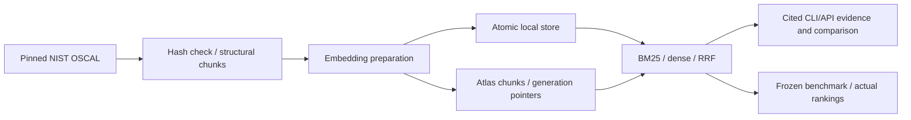

# Compliance retrieval: design and results

**Evidence and provenance.** Public NIST Rev4 (`2015-01-22`) and Rev5 (`5.2.0`, including assessment procedures) catalogs are bundled as gzip; immutable URLs, SHA256 and versions are in `src/data/manifest.json`. The [pinned NIST repository](https://github.com/usnistgov/oscal-content/tree/78650f02ad9321bb7b817846f8fbd4f2bcd620de) [license](https://github.com/usnistgov/oscal-content/blob/78650f02ad9321bb7b817846f8fbd4f2bcd620de/LICENSE.md) is US public domain/worldwide CC0. Attribution: National Institute of Standards and Technology, SP 800-53 OSCAL catalogs. Structural parsing traverses groups and nested controls, preserving control identifiers, section paths, parameters, releases, URLs and hashes; group records are not indexed separately. Metadata-only controls retain cited status and links, including withdrawal/incorporation evidence. Prose splits at 180 words without crossing sections. Organization-defined parameter definitions remain separate cited sections; values are never invented.

**Architecture and tradeoffs.** The enterprise KMS reference informed filtered Atlas pipelines and batched preparation; application state, providers and private configuration were not copied. [IBM Blended-RAG](https://github.com/ibm-self-serve-assets/Blended-RAG) informed the dense/lexical comparison. IBM's Elasticsearch ELSER mappings cannot be reused as MongoDB indexes; BM25 is not learned sparse retrieval. Local BM25 uses k1=1.5/b=.75; default dense is seeded normalized TF-IDF/SVD64, a corpus-fitted LSA baseline. Optional pinned MiniLM provides neural vectors with incremental reuse but has not been executed here. Client RRF (constant 60, up to 100 candidates per retriever) provides Atlas compatibility without claiming native `$rankFusion` support, ELSER parity or reranker results. Identical metadata constraints apply within both Atlas retrieval stages.

**Updates and deployment.** Embeddings are prepared before atomic local store replacement. Identical reingestion embeds zero chunks; replacing one source/release preserves other releases. LSA changes refit the corpus and require a fresh Atlas collection/model generation. Atlas upserts deterministic source-scoped generation IDs in batches before switching each source pointer; failures leave old pointers usable. A multi-source batch is not one transaction; retired generations need a retention policy, and Search propagation may temporarily hide new evidence. Use serialized source updates in a production ingestion queue; Service Bus is optional. Docker runs the local FastAPI service; Atlas requires externally provisioned Search/Vector Search and configured index permissions. The API is an internal demo: add authenticated gateway/document access rules before enterprise exposure. The local JSON/LSA store is not designed for millions of documents; fixed-model workers and Atlas scale independently after distributed ingestion coordination is added.

**Benchmark interpretation.** Sixteen frozen questions include identifiers, paraphrases, multi-control questions, release/source filters and two negatives. Labels are source-derived seeds with **no independent human validation** and incomplete relevance judgments. Results demonstrate reproducibility, not proven superiority. Each method retrieves 100 chunks and collapses them into unique `release:control_id` rankings. Positive-query means exclude the two empty-qrel negatives; negative return counts are separate. Recall@5/10, MRR, NDCG@10, Precision@5/10 and p50/p95 come from actual rankings. Latency is one warm retrieval pass, including filtering/fusion but excluding model loading, ingestion and API generation. Sequential throughput is not concurrent capacity. Run `python src/main.py evaluate --output artifacts/evaluation.json` for complete per-query evidence, environment, corpus/model/query hashes and resource measurements.

**Measured run.** Executed offline on Python 3.13.11/Windows: 20,114 chunks from 922 Rev4 and 1,196 Rev5 control records, including withdrawn controls. Initial ingestion took 8.27 seconds (2,432.6 chunks/s), producing a 41,868,827-byte local store and 4,133,778-byte encoder. Reingestion embedded zero chunks. All commands in `run.yaml` were rerun in an isolated virtual environment after review fixes. The final run produced:

| Method | Recall@5 | Recall@10 | MRR | NDCG@10 | P@5 | P@10 | p50 / p95 ms |
|---|---:|---:|---:|---:|---:|---:|---:|
| lexical | 0.7857 | 0.8214 | 0.7695 | 0.7727 | 0.1857 | 0.1000 | 123.7 / 198.4 |
| dense | 0.8214 | 0.8214 | 0.6917 | 0.7054 | 0.1857 | 0.0929 | 62.2 / 101.6 |
| hybrid | 0.8571 | 0.8571 | 0.8095 | 0.7849 | 0.2000 | 0.1000 | 184.2 / 267.5 |

Hybrid Recall@10 was 0.8571 versus lexical 0.8214; NDCG@10 was 0.7849 versus lexical 0.7727. Hybrid queries with incomplete Recall@10: semantic-recovery, semantic-login, multi-audit. The two negative seeds returned no evidence, which does not establish reliable out-of-domain abstention. Local embedding and LLM API calls cost $0 because none are made; CPU/storage costs remain unpriced. Atlas latency/index size/storage charges and neural-model performance are unmeasured. No live Atlas or Docker execution is claimed. Machine-readable measurements are in `benchmark-summary.json`; full rankings are regenerated by the evaluation command.

**Limits and failures.** Extractive answers quote evidence; similarity alone does not prove that it answers a question. Empty retrieval returns insufficient evidence, but dense retrieval may return unrelated excerpts for out-of-domain questions. Mixed-release answers carry a warning. Comparisons show exact textual differences and absent controls, without inferring legal/policy changes. No LLM synthesis, reranker, tenant authorization, monitoring exporter, distributed locking or validated benchmark is implemented. Prioritize independent qrel review, neural evaluation and live Atlas integration before drawing quality/scaling conclusions.
