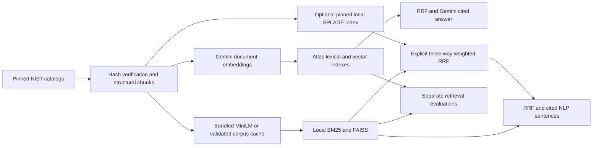

# Local compliance Blended RAG

Local indexed BM25 + bundled quantized ONNX MiniLM/FAISS + explicitly optional SPLADE is the primary research architecture. The credential-free grading route keeps its two-way BM25/MiniLM hybrid default; optional three-way blended retrieval requires explicit pinned model setup and sparse indexing. MongoDB Atlas plus Gemini remains the hybrid fallback. Read the [local sparse architecture and limits](local-splade.md), [execution commands](architecture-modes.md), and [historical independent measurements](mode-benchmarks.md). Stored measurements retain their original meaning.

The [reproduction/evidence guide](grading-guide.md) maps each requested deliverable to code, commands and meaningful tests. [Detailed architecture diagrams](system-architecture.md) show independent indexes, query branches, fusion, answers and deployment boundaries.

## Documents and chunking

Two public NIST SP 800-53 OSCAL catalogs provide 20,114 chunks from 922 Rev4 and 1,196 Rev5 control records. These are real security standards, not invented corporate 2024/2025 policies. Rev4 uses catalog version `2015-01-22`; Rev5 uses `5.2.0`, including assessment procedures. Manifest URLs, versions and SHA256 values are in `src/data/manifest.json`. The [pinned NIST source repository](https://github.com/usnistgov/oscal-content/tree/78650f02ad9321bb7b817846f8fbd4f2bcd620de) has a [US public-domain/worldwide CC0 license](https://github.com/usnistgov/oscal-content/blob/78650f02ad9321bb7b817846f8fbd4f2bcd620de/LICENSE.md).

The parser traverses nested groups and controls, preserves exact control IDs and section paths, and splits prose at 180 words without crossing sections. Parameter definitions remain separate; organizational parameter values are never invented. Metadata-only controls preserve withdrawal/incorporation evidence. Every chunk carries release, source URL and source/content hashes.

## Retrieval and answers

Enterprise mode prepares Gemini `RETRIEVAL_DOCUMENT` embeddings and embeds questions with `RETRIEVAL_QUERY`. Atlas Search performs lexical matching with its BM25 scoring; Atlas Vector Search uses 768-dimensional cosine similarity. Local BM25 uses k1=1.5 and b=0.75. Local dense retrieval uses the pinned 384-dimensional MiniLM quantized ONNX representation with attention-mask mean pooling, normalization and FAISS IndexFlatIP. Metadata filters apply before top-k in both modes.

Both pipelines combine ranked lists using client RRF, constant 60 and up to 100 candidates per component. This follows the dense/lexical comparison in [IBM Blended-RAG](https://github.com/ibm-self-serve-assets/Blended-RAG); it does not claim ELSER, native MongoDB rank fusion or tested reranking. The existing KMS POC informed Atlas design; new collection/index namespaces isolate this experiment from its data.

Local answers select relevant exact source sentences and append citations. This is an NLP answer presentation layer, with an uncalibrated lexical abstention heuristic. Enterprise uses Gemini structured synthesis over bounded excerpts and validates citation IDs. Neither citation validation nor similarity proves semantic entailment. Version comparison returns cited excerpts and exact textual diffs; it does not infer legal or operational changes.

## Evaluation protocol

The same frozen 16 questions and source/query hashes are used for each mode. Fourteen have positive source-derived relevance labels; two are negatives. Labels are small, incomplete and independently unvalidated. Each method retrieves 100 chunks, collapses them to unique `release:control_id`, then calculates Recall@5/10, MRR, NDCG@10 and precision. A Recall@10 of 1.0 means all labeled controls appeared in that ranking on these seeds; it does not mean answers are 100% correct.

One untimed dense warmup precedes a single sequential timed pass. Latency includes retrieval, filters and fusion, but excludes ingestion, model loading and answer generation. Reports retain all rankings, evidence hashes, negative-return counts, p50/p95, usage and environment. Warmup calls are counted separately. Results are reproducibility evidence, not a statistical superiority claim or concurrent load test. See [mode-benchmarks.md](mode-benchmarks.md) for actual separate results and costs.

The preserved `benchmark-summary.json`, `experiment-summary.json`, `measurements/local-lsa.json.gz` and `measurements/local-minilm.json.gz` describe earlier LSA and full-precision MiniLM experiments. They remain intact and are not Atlas/Gemini or quantized ONNX measurements.

## Updates, scale and deployment

Fixed-model ingestion reuses unchanged vectors and preserves other source/releases. The bundled corpus cache is generated by actual MiniLM encoding and bound to complete ordered source/chunk records and the model fingerprint. Query encoding and retrieval always execute. Failed preparation preserves the previous local store pointer. Atlas writes deterministic generation-scoped chunks before switching each source pointer; a multi-source upload is not one transaction. Search propagation remains eventually consistent. Retired generations require retention cleanup.

For production, serialize source updates with distributed coordination; a Service Bus ingestion queue is optional and is not required by this working CLI/API. Scale embedding workers and Atlas separately. The local JSON store and filtered temporary FAISS subsets target this assessment corpus, not millions of documents. The single-process demo API serializes query operations to keep tokenizer and usage attribution safe. Production requires authentication, document authorization, operational monitoring and measured concurrent capacity.

`Dockerfile` builds and serves local mode using the bundled assets. Dependency installation requires a package source; application runtime does not require cloud services or downloads. Exact CLI/API, Docker and optional cloud instructions are linked above. A Docker engine/build and Linux runtime must be independently verified before claiming those executions.
