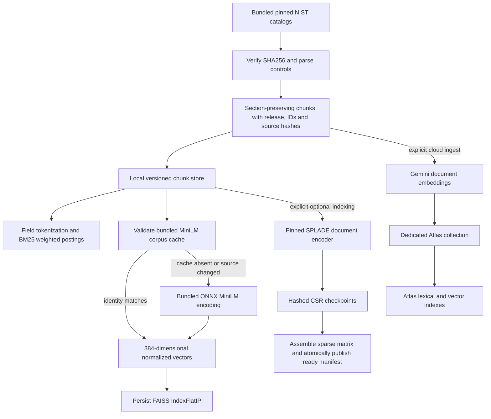
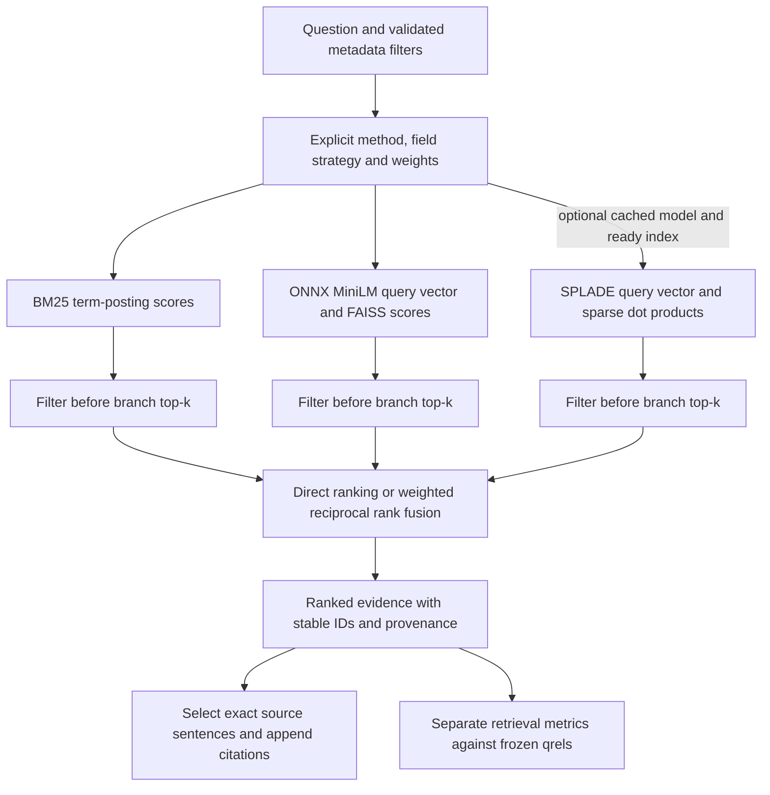
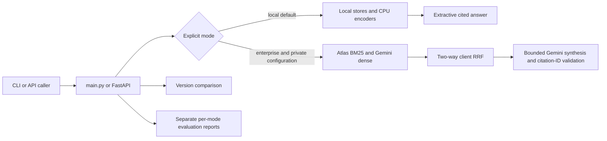

# Retrieval architecture

Local retrieval is primary. MongoDB Atlas/Gemini is an explicitly configured hybrid fallback. All diagrams describe the implemented boundaries; an optional component requires its documented setup before use.

## Indexing and persistence

BM25 stores separate CSC matrices for combined text and individual fields so a term query follows its postings. SPLADE stores weighted learned-vocabulary vectors as a CSR matrix and ranks with sparse dot products. These are different representations. Source/model identities prevent reusing an index for incompatible chunks or encoders. Neither FAISS nor ordinary Atlas text indexes score SPLADE vectors in this implementation.

## Local query execution

`lexical`, `dense`, and `sparse` return their direct rankings. `hybrid` uses BM25+dense; `blended` additionally uses SPLADE with positive sparse weight. Zero-weight branches are skipped. Ranking ties are deterministic. Retrieval evaluation does not invoke answer generation. Version comparison follows a separate exact-text comparison path over the selected releases.

## CLI/API and cloud boundary

The single-worker API serializes query operations to keep shared provider usage counters attributable. No automatic cloud-to-local failover occurs. Atlas rejects sparse/three-way methods. Model setup/download is explicit; normal cached SPLADE inference does not download weights. Default local runtime has no network dependency after package installation.

The Dockerfile serves the default local application. Docker/Linux runtime and production concurrent capacity remain unverified. An ingestion queue such as Service Bus is a possible production extension, not part of the demonstrated query path. See [execution/configuration](architecture-modes.md), [sparse limits](local-splade.md), and [requirement evidence](grading-guide.md).
